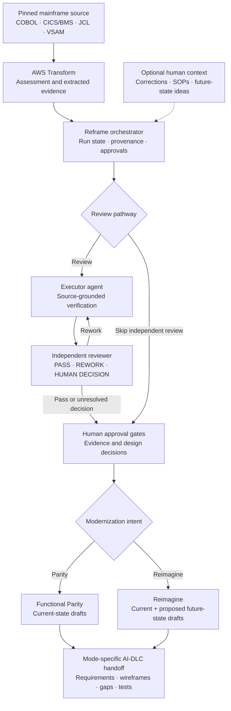
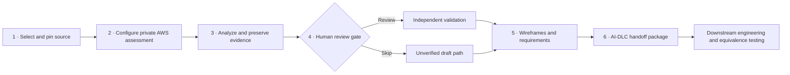

# Reframe

**From legacy mainframe code to evidence-backed modernization plans.**

Reframe is an open-source CLI for understanding mainframe applications before rebuilding them. It connects pinned source code to AWS Transform assessments, optional independent AI review, human decisions, HTML wireframe drafts, and AI-assisted development lifecycle (**AI-DLC**) handoff packages.

**Reframe prepares a modernization project; it does not translate the application into production code, deploy a target system, or prove runtime equivalence.** The target language and architecture are decisions for the implementing team.

[](https://github.com/sknampally/reframe/actions/workflows/ci.yml)
[](pyproject.toml)
[](LICENSE)
[](docs/limitations.md)

> **Project maturity:** The CLI and offline workflows have been exercised with fixtures. A CardDemo AWS assessment has reached a human-review gate, but uninterrupted live AWS/provider acceptance, production application buildout, and behavioral equivalence are **not** established. Generated implementation packages remain drafts until required reviews and evidence gates are satisfied.

## Why Reframe?

Modernizing COBOL, CICS, VSAM and JCL is not simply converting syntax. Teams must recover business rules, data semantics, screen behavior, batch dependencies, operational assumptions and the decisions that exist outside the code. AI-generated documents can accelerate discovery, but need traceable evidence and human approval.

Reframe organizes that work into a controlled, repeatable preparation flow:

- **Source-first:** Pin a Git repository revision or supplied source package and preserve provenance.
- **Assessment-backed:** Use AWS Transform to inventory and analyze the mainframe workload.
- **Reviewable:** Optionally run an executor and independent reviewer; keep unresolved findings visible.
- **Human-informed, not human-dependent:** Add business clarifications and future-state ideas when available. Source-only draft preparation remains possible.
- **Mode-aware:** Prepare *Functional Parity* or *Reimagine* design drafts without confusing intended changes with verified legacy behavior.
- **Portable handoff:** Export HTML previews and AI-DLC packages for a subsequent implementation team.

## Architecture



**Trust boundary:** AWS Transform findings, AI interpretations and human-provided statements are separate evidence layers. A model's `PASS` is not a substitute for stakeholder approval; skip mode does not certify the findings.

## The workflow



Reframe preserves existing assessment state and can resume interrupted workflows. AWS connector and resource setup, source upload and human decisions have explicit operational boundaries. See the [four-phase workflow](docs/four-phase-workflow.md) and [CLI guide](docs/cli-guide.md).

## Quick start

**Supported workstation path:** macOS or Linux; Windows through Ubuntu/WSL2. Follow the [platform setup guide](docs/platform-install.md) and [engineer setup guide](docs/engineer-setup.md) for Git, `uv`, Python, AWS CLI, OpenTofu, provider CLI authentication and AWS Transform application access.

From a clean checkout:

```bash
git clone https://github.com/sknampally/reframe.git
cd reframe
uv tool install --force --managed-python --python 3.12 --editable .
reframe
```

Choose **1 — Guided start / continue**. Provide your own GitHub source URL or clean local checkout, private output directory, AWS profile and region, and chosen agent/provider. Reframe checks prerequisites before creating an assessment sandbox. **AWS operations require your account, permissions and explicit confirmations; do not use real client code without authorization.**

To inspect the UI without contacting cloud or AI services:

```bash
reframe demo
```

### Example paths

| Path | What happens | Output / caveat |
| --- | --- | --- |
| **Skip validation** | Use assessment findings without the independent executor/reviewer pass | HTML wireframe and AI-DLC **draft**, marked unverified |
| **Independent review** | Executor checks evidence; reviewer challenges claims; human decisions gate progress | Reviewed specifications and gated package workflow |
| **Functional Parity** | Prepare source-grounded current-state drafts | `previews/<version>/current-state/` and mode-specific draft ZIP |
| **Reimagine** | Keep the current-state baseline and propose future-state screens and flows | `previews/<version>/future-state/`; proposals remain unapproved until accepted |

Human-review context is optional. Accepted comments and supporting text can inform design exports; the current opt-in export is **not** a full model-driven regeneration of every screen. Older preview and package paths remain supported.

For commands such as `context`, `design-export`, `package-export` and `register-project`, use the [CLI command reference](docs/cli-guide.md). New run planning and project registry logic have offline test coverage; **live AWS resource reuse is not yet verified**.

## Deliverables and quality gates

Reframe separates preparation outputs from completed modernization:

| Output | Purpose | Evidence boundary |
| --- | --- | --- |
| Source and assessment records | Inventory, dependencies, data and extracted rules | Source-pinned; verify Transform coverage |
| Business review and wireframes | Screens, navigation, rules and proposed journeys | Generated material, not automatically approved |
| Human decision records | Clarifications, conflicts, approvals and deferrals | Preserve provenance and unresolved decisions |
| AI-DLC handoff packages | Requirements, designs, guidance and test planning inputs | Opt-in mode packages are **DRAFT**, not complete build contracts |
| Target application | Implemented and operated by a downstream team | **Not generated or validated by this POC** |

Financial rules, authorization, EBCDIC data conversion, batch restart, concurrency and data equivalence require explicit validation. The [quality gates](quality-gates/README.md), [contracts](contracts/README.md), and [limitations](docs/limitations.md) describe the controls.

## Documentation

| Start with | Read |
| --- | --- |
| Install on your workstation | [Platform installation](docs/platform-install.md) · [Engineer setup](docs/engineer-setup.md) |
| Operate Reframe | [CLI guide](docs/cli-guide.md) · [Terminal console](docs/terminal-console.md) |
| Understand the process | [Four-phase workflow](docs/four-phase-workflow.md) · [Multi-agent workflow](architecture/multi-agent-workflow.md) |
| Examine security boundaries | [Sandbox infrastructure](infrastructure/README.md) · [Security policy](SECURITY.md) |
| Review methodology | [Modernization methodology](methodology/modernization.md) · [Quality gates](quality-gates/README.md) |
| Reproduce a safe example | [CardDemo example](examples/carddemo/README.md) · [Assessment comparison](docs/assessment-comparison.md) |
| Contribute | [Contributing](CONTRIBUTING.md) · [Third-party guidance](THIRD_PARTY.md) |

## Development and CI

Run the offline test suite from the repository with its dependencies installed:

```bash
PYTHONPATH=tests python -m unittest discover -s tests
reframe --help
```

The [CI workflow](.github/workflows/ci.yml) is configured for pull requests to `main` and pushes to `main`, covering offline tests, package validation and secret scanning. **The badge reflects GitHub's actual workflow result; it is not a claim of live AWS acceptance.** No AWS credentials or paid model calls are required by CI.

## Security, licensing and scope

Keep source assessments, account identifiers, credentials and client documents in private workspaces—**never in this public repository or public issues**. Do not upload third-party source without authorization. Reframe itself is [MIT licensed](LICENSE); [AWS CardDemo](https://github.com/aws-samples/aws-mainframe-modernization-carddemo) remains an independent sample under its own license. See [SECURITY.md](SECURITY.md) and [THIRD_PARTY.md](THIRD_PARTY.md).

This framework has been developed with AI assistance. Humans are responsible for interpreting evidence, approving decisions and validating any resulting application.
