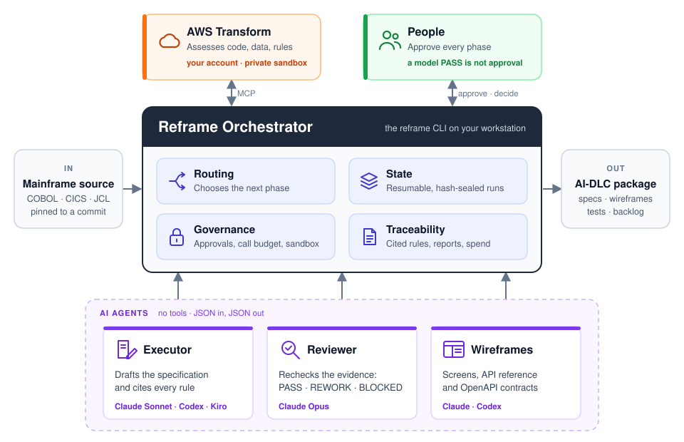

# Reframe

**From legacy mainframe code to evidence-backed modernization plans.**

Reframe is an open-source CLI for understanding mainframe applications before rebuilding them. It connects pinned source code to AWS Transform assessments, optional independent AI review, human decisions, HTML wireframe drafts, and AI-assisted development lifecycle (**AI-DLC**) handoff packages.

**Reframe prepares a modernization project; it does not translate the application into production code, deploy a target system, or prove runtime equivalence.** The target language and architecture are decisions for the implementing team.

[](https://github.com/sknampally/reframe/actions/workflows/ci.yml)
[](pyproject.toml)
[](LICENSE)
[](docs/limitations.md)

> **Project maturity:** The CLI and offline workflows have been exercised with fixtures. A CardDemo AWS assessment has reached a human-review gate, but uninterrupted live AWS/provider acceptance, production application buildout, and behavioral equivalence are **not** established. Generated implementation packages remain drafts until required reviews and evidence gates are satisfied.

## Why Reframe?

Modernizing COBOL, CICS, VSAM and JCL is not simply converting syntax. Teams must recover business rules, data semantics, screen behavior, batch dependencies, operational assumptions and the decisions that exist outside the code. AI-generated documents can accelerate discovery, but need traceable evidence and human approval.

Reframe organizes that work into a controlled, repeatable preparation flow:

- **Source-first:** Pin a Git repository revision or supplied source package and preserve provenance.
- **Assessment-backed:** Use AWS Transform to inventory and analyze the mainframe workload.
- **Reviewable:** Optionally run an executor and independent reviewer; keep unresolved findings visible.
- **Human-informed, not human-dependent:** Add business clarifications and future-state ideas when available. Source-only draft preparation remains possible.
- **Mode-aware:** Prepare *Functional Parity* or *Reimagine* design drafts without confusing intended changes with verified legacy behavior.
- **Portable handoff:** Export HTML previews and AI-DLC packages for a subsequent implementation team.

## How it works

Reframe is an orchestrator. It runs on your workstation, drives an AWS Transform assessment, hands bounded evidence to separate AI agents, and stops for a person at every approval.



| Part | Runs as | What it does |
| --- | --- | --- |
| **Orchestrator** | The `reframe` CLI on your machine | Pins the source revision, uploads it to AWS Transform, seals the findings, gives each agent only the evidence it needs, enforces the model-call budget, records approvals and writes the packages. It is the only part that touches files or AWS. |
| **AWS Transform** | Your AWS account, in a private sandbox | Inventories programs, data and jobs, generates technical documentation and extracts business rules. |
| **Executor agent** | Claude Sonnet by default (Codex or Kiro optional) | Reads the source and the AWS findings and writes a candidate specification, with every rule cited to a file and line. |
| **Reviewer agent** | Claude Opus, always a different model from the executor | Checks the candidate against the same evidence and returns `PASS`, `REWORK` (back to the executor) or `BLOCKED` (needs a person). |
| **Wireframe agent** | Codex or Claude, your choice | Turns the approved specification into linked HTML wireframes, an API reference and OpenAPI contracts. |
| **People** | You and your reviewers | Approve the assessment, answer SME questions, approve the specification and the wireframes. A model's `PASS` never counts as approval. |

The agents run with no tools, so they cannot read files, call AWS or change anything. They return JSON, and the orchestrator decides what happens next.

A run moves through four phases: assess, validate, wireframes and package, with a human approval after each of the first three. After the assessment is approved you choose a route. **Skip** goes straight to draft wireframes and a draft AI-DLC ZIP, built from the AWS findings alone and labelled unverified. **Review** runs phases 2 to 4 and is the only route that produces the approved package. Every step is saved, so you can stop at any point and continue later. See the [four-phase workflow](docs/four-phase-workflow.md) and [multi-agent workflow](architecture/multi-agent-workflow.md) for more detail.

## How to run

**Supported workstations:** macOS or Linux. On Windows, use Ubuntu under WSL2.

### 1. Install the tools

| Tool | Needed for | Check it with |
| --- | --- | --- |
| Git | Always | `git --version` |
| uv with Python 3.10+ | Always | `uv --version` |
| AWS CLI v2 | Running an assessment | `aws --version` |
| OpenTofu 1.5+ | Creating the AWS sandbox | `tofu version` |
| Claude Code CLI | Executor and reviewer agents | `claude --version` |
| Codex CLI | Only if Codex writes the wireframes | `codex --version` |
| Kiro CLI | Only if Kiro is the executor | `kiro-cli --version` |

The [platform installation guide](docs/platform-install.md) and [engineer setup guide](docs/engineer-setup.md) have install commands for each tool and fixes for PATH problems.

### 2. Sign in

Sign in to each service you will use. Reframe checks these, but it never collects credentials itself.

```bash
aws sso login --profile your-profile
```

```bash
claude auth login
```

```bash
codex login
```

`aws sts get-caller-identity --profile your-profile` confirms the AWS session. Your AWS identity needs permission to create an S3 bucket and IAM role for the sandbox and to use AWS Transform workspaces, jobs and connectors. Guided setup also connects to the AWS Transform application, which is a separate browser sign-in.

### 3. Install Reframe

```bash
git clone https://github.com/sknampally/reframe.git
cd reframe
uv tool install --force --managed-python --python 3.12 --editable .
reframe --help
```

Keep this checkout in place and unchanged while a run is active: Reframe loads its prompts and contracts from it.

### 4. Try the demo (optional)

```bash
reframe demo
```

The demo walks through every stage with simulated data. It calls no AWS or AI service.

### 5. Run the guided flow

```bash
reframe
```

Choose **1 · Guided start / continue**. You can also type `/flow` at any time to continue a saved run. The guide asks for:

- **Source:** a GitHub URL or a clean local Git checkout. Reframe pins the current commit.
- **Workspace directory:** where outputs go. Reframe creates a `<repo>_assessment` folder inside it. Keep it private and outside this repository.
- **Scope:** which business journey to assess, or the whole repository.
- **AWS profile and region:** if your SSO session has expired, the guide offers to sign you in.
- **Executor:** `claude` (default), `codex` or `kiro`.
- **Wireframe provider:** `claude` or `codex`.

Reframe then creates the sandbox with OpenTofu: one S3 bucket and one role per source. It checks that the role cannot read any other bucket in the account, then creates the AWS Transform workspace and connector. Nothing is uploaded until you confirm.

### 6. Assess and approve

Confirm the source upload when asked. Reframe starts the AWS Transform job and waits for it to finish, which can take a while. If you leave, run `reframe` again and choose **1** to pick up the same job.

When the findings are downloaded, Reframe lists the files to review, including `assessment-review.html`. Approve them with your name, a short note, and confirmation that the findings match the pinned source.

### 7. Choose skip or review

| Choice | What runs | What you get |
| --- | --- | --- |
| **skip** (default) | Wireframe agent only, using the AWS findings as they are. You record your name and why you trust them. | HTML wireframes and `ai-dlc-draft.zip`, labelled unverified |
| **review** | Executor and reviewer agents, then your approvals, then the wireframe agent | An approved, checksummed AI-DLC package |

On the **review** route, the guide takes you through each step in order:

1. **Validate.** The executor and reviewer check the evidence program by program. If the saved model-call cap is too low, the guide tells you how many calls are needed and asks before raising it (256 at most).
2. **Answer SME questions.** Open `preparation/review.html`. Answer each open question with `reframe decide`, or defer it with a named owner. Then approve validation.
3. **Review the wireframes.** Reframe generates `index.html`, `api.html` and `openapi.json`. To ask for changes, run `reframe feedback`; this sends the work back to the executor and clears the later approvals. When you are happy, approve the specifications.
4. **Package.** Reframe writes `packages/package-<version>.zip` for the implementation team.

After the package exists you can optionally export a **Functional Parity** (current-state) or **Reimagine** (current plus proposed future-state) design as a separate draft package.

### 8. Check progress and find outputs

```bash
reframe status
```

`status` shows the current stage, the approvals recorded and the next command to run. `reframe resume` continues interrupted work. Inside the workspace folder:

| Folder | Contents |
| --- | --- |
| `runs/<run>/` | Sealed AWS findings and `assessment-review.html` |
| `preparation/` | Executor and reviewer output and `review.html` |
| `previews/` | Wireframe sites, for both the skip and review routes |
| `packages/` | Draft and approved AI-DLC ZIPs |
| `reports/index.html` | Links to every report for this run |

### Running without the menu

Every step is also a command, for scripts or for picking up one step by hand. Approvals need `--by` and `--note`, and nothing is approved by default.

```bash
reframe assess --allow-new-assessment --wait
reframe approve assessment --by "Your name" --note "Reviewed findings" --confirm-source-match

# Skip route
reframe preview --skip-validation --by "Your name" --note "Use the AWS findings" --provider claude --name draft-1

# Review route
reframe validate
reframe decide --question QUESTION_ID --by "SME name" --answer "Decision" --disposition resolved
reframe approve validation --by "Architect name" --note "Reviewed report and decisions"
reframe review-site --provider claude
reframe approve specifications --by "Business owner" --note "Reviewed the wireframes"
reframe package
```

The [CLI guide](docs/cli-guide.md) covers every command and flag, including design exports, comparing two assessments and recovering from a blocked run.

## Deliverables and quality gates

Reframe separates preparation outputs from completed modernization:

| Output | Purpose | Evidence boundary |
| --- | --- | --- |
| Source and assessment records | Inventory, dependencies, data and extracted rules | Source-pinned; verify Transform coverage |
| Business review and wireframes | Screens, navigation, rules and proposed journeys | Generated material, not automatically approved |
| Human decision records | Clarifications, conflicts, approvals and deferrals | Preserve provenance and unresolved decisions |
| AI-DLC handoff packages | Requirements, designs, guidance and test planning inputs | Opt-in mode packages are **DRAFT**, not complete build contracts |
| Target application | Implemented and operated by a downstream team | **Not generated or validated by this POC** |

Financial rules, authorization, EBCDIC data conversion, batch restart, concurrency and data equivalence require explicit validation. The [quality gates](quality-gates/README.md), [contracts](contracts/README.md), and [limitations](docs/limitations.md) describe the controls.

## Documentation

| Start with | Read |
| --- | --- |
| Install on your workstation | [Platform installation](docs/platform-install.md) · [Engineer setup](docs/engineer-setup.md) |
| Operate Reframe | [CLI guide](docs/cli-guide.md) · [Terminal console](docs/terminal-console.md) |
| Understand the process | [Four-phase workflow](docs/four-phase-workflow.md) · [Multi-agent workflow](architecture/multi-agent-workflow.md) |
| Examine security boundaries | [Sandbox infrastructure](infrastructure/README.md) · [Security policy](SECURITY.md) |
| Review methodology | [Modernization methodology](methodology/modernization.md) · [Quality gates](quality-gates/README.md) |
| Reproduce a safe example | [CardDemo example](examples/carddemo/README.md) · [Assessment comparison](docs/assessment-comparison.md) |
| Contribute | [Contributing](CONTRIBUTING.md) · [Third-party guidance](THIRD_PARTY.md) |

## Development and CI

Run the offline test suite from the repository with its dependencies installed:

```bash
PYTHONPATH=tests python -m unittest discover -s tests
reframe --help
```

The [CI workflow](.github/workflows/ci.yml) is configured for pull requests to `main` and pushes to `main`. It runs three jobs in parallel: offline tests, a package build check, and a pinned gitleaks secret scan. **The badge reflects GitHub's actual workflow result; it is not a claim of live AWS acceptance.** No AWS credentials or paid model calls are required by CI.

## Security, licensing and scope

Keep source assessments, account identifiers, credentials and client documents in private workspaces—**never in this public repository or public issues**. Do not upload third-party source without authorization. Reframe itself is [MIT licensed](LICENSE); [AWS CardDemo](https://github.com/aws-samples/aws-mainframe-modernization-carddemo) remains an independent sample under its own license. See [SECURITY.md](SECURITY.md) and [THIRD_PARTY.md](THIRD_PARTY.md).

This framework has been developed with AI assistance. Humans are responsible for interpreting evidence, approving decisions and validating any resulting application.
