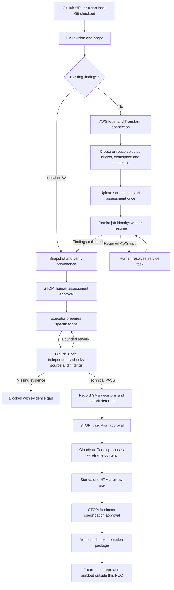

# Modernization preparation CLI

For first installation, updates and troubleshooting on Mac or Windows/WSL2, follow
[the platform installation guide](platform-install.md). Every install command includes the required trailing dot.

The `reframe` entry point prepares a reviewed implementation package. It does not
build a target application, deploy infrastructure for that application, migrate data,
or prove behavioral equivalence. AWS assessment resources are the only cloud
resources this CLI can create.

**Status:** implemented and covered by offline tests, including a synthetic
four-phase acceptance path. Full live AWS/Kiro/Claude Code/Codex workflow acceptance is still pending. A small synthetic Claude model connectivity check is separate from application-level acceptance. Do not describe fixture results as a CardDemo result.
Python 3.10+ on macOS/Linux is required; Windows is not supported by the current
file-lock/process-group implementation. Run from a clean committed framework checkout.

See [live assessment readiness](live-assessment-readiness.md) for the recovery
steps implemented in the CLI, administrator boundaries and remaining acceptance
checks. A manually recovered cloud run is not a CLI-only acceptance result.

## Start here: guided CLI

Prefer a menu interface? Launch `reframe` for the [Reframe terminal console](terminal-console.md).
Use `reframe demo` for a clearly labeled, service-free presentation preview.

First install the required tools and configure your AWS profile using the
[engineer workstation guide](engineer-setup.md). It includes uv/Python, AWS CLI v2,
Claude Code, optional Codex/Kiro, authentication and PATH troubleshooting.

Install once from a clean checkout with Python 3.10+ and uv available:

```bash
uv tool install --force --python 3.12 --editable .
reframe init
```

If the command is not found, ensure uv's tool executable directory is on PATH
(`uv tool update-shell` can guide that setup), then reopen the terminal. The editable
installation is required in this POC: the CLI loads versioned prompts and source
contracts from its Git checkout. Keep that checkout available and unchanged during
an active run. This is not yet a standalone distributable wheel.

`init` guides you through the private workspace, local Git checkout or GitHub URL,
source revision, business scope, AWS profile/region/bucket, executor runtime and HTML
provider. It saves choices outside Git and checks required executables, Claude login,
AWS credentials and selected runtime authentication. AWS profile access is checked
after profile/region selection; setup offers SSO configuration or sign-in when
needed and rechecks access before advancing. Declined/failed login stops setup.
Missing tools or other provider logins produce
instructions; it does not install software or collect credentials. Kiro is checked
only when selected. Codex login is checked when selected. The default pair remains
Claude Sonnet executor and Claude Opus reviewer.

The guide first checks the Transform application connection. A valid connection is
reused. Otherwise it offers browser SSO, using the Identity Center start URL and
region from the saved AWS profile when available. The Transform application profile
name is separate from the AWS CLI profile. Connection is rechecked before resource
questions appear. No MCP client JSON or manual configuration file is needed for
normal setup. An advanced file option accepts only a path to authentication arguments,
never an `mcpServers` client configuration. The guide then offers existing or new AWS resources. It asks for confirmation before creating resources.
It presents the connector activation link, requires the operator's confirmation
and verifies that AWS reports the connector ACTIVE in the selected account,
and suggests `reframe assess` only when setup is ready. Administrator activation
and Transform application authentication remain real boundaries. No assessment job
starts during `init`. Rerun `reframe init` to continue incomplete setup without
recloning source or deleting evidence. If the framework was updated before any
assessment/approval exists, setup can explicitly confirm a new framework baseline
while keeping the pinned source unchanged. Existing assessment baselines are never
repinned.

Normal commands now reuse the saved active workspace:

```bash
reframe assess --source <same-github-url-or-local-path>
reframe status
reframe resume
reframe approve assessment
reframe validate --reviewer claude-code
reframe approve validation
reframe review-site --provider codex
reframe approve specifications
reframe package
```

The `--source` on assess is optional and must match the pinned setup; a different
source requires a new workspace. Each unlabelled assess chooses run-1, run-2, etc.;
resume selects the active run and never invents one. If a validation or HTML-generation call was interrupted, resume routes back to that saved phase instead of calling AWS. New AWS runs prompt for explicit
source-upload/job authorization. Approvals prompt for owner, rationale and source
provenance confirmation; they are never inferred. Validation approval after SME
questions remains an explicit gate before HTML generation.

When a new job asks for its initial custom plan, the controller sends the four
assessment capability names with the saved source, connector and scope. It records
each message before sending and retains its receipt. Resume uses the same job;
uncertain sends require reconciliation. Plan selection never approves generated
deliverables, and unknown onboarding prompts are not automatically answered.

For newly authorized uploads, the recognized kickoff source-location task is
filled with the recorded ZIP URI after its task identity, response schema and
archive checksum are checked. This changes no optional chat/features and approves
no generated findings. Source submissions retain intent and receipts; uncertain
outcomes require reconciliation. Non-blocking collaborator invitations remain
untouched and do not prevent polling. Other blocking tasks require human input.

For the experiment, use `reframe assess` twice after the first completes, then
`reframe compare --left run-1 --right run-2`. Optional `--label` still selects names.
`--workspace /private/path` overrides the active selection. A private pointer is stored
at `~/.config/mainframe-modernize/active.json`; project settings remain in the chosen
workspace. The CLI outputs the next recommended step, while missing access or evidence
stops progression.

For unattended use, supply the explicit flags below: new assessments require
`--allow-new-assessment`; approvals require `--by`, `--note` and, for assessment,
`--confirm-source-match`. There is no default approval in noninteractive mode.

## Advanced and scripted usage

The examples below expose the underlying settings and phase commands for diagnostics
and automation. Installed `reframe` already includes the MCP dependency; repeating
`uv run --with ...` is unnecessary for normal use.

## Four phases



## 1. Initialize once

Authenticate Git if using a private GitHub repository. Authenticate AWS in your own
terminal, for example `aws sso login --profile <your-profile>` for a previously
configured SSO profile. The framework does not collect passwords or store AWS keys.

```bash
./reframe --workspace /path/to/private-poc init \
  --source https://github.com/aws-samples/aws-mainframe-modernization-carddemo.git \
  --ref <full-reviewed-source-commit> \
  --scope "CardDemo sign-on journey; exclude other application journeys" \
  --aws-profile <your-profile> --region <your-region> --bucket <your-private-bucket> \
  --executor claude --ui-provider codex
```

For local source, pass its clean Git checkout path and omit `--ref`. Source is not
edited. GitHub sources are cloned to the private workspace without running repository
hooks or installing project dependencies. The clone is pinned; changing source or
framework revision requires a new workspace. Record the same source commit for both
comparison runs. Assessment uploads currently contain safe tracked repository files;
the scope narrows the requested analysis, not the archive. Inspect the upload manifest
and authorize the entire source before a new assessment. Hidden files and obvious
credential filenames are excluded; this is **not** secret detection.

The private workspace must be outside framework/source checkouts. Keep all findings,
cloud identities and generated packages private. A package may contain sensitive
business information even though it excludes raw AWS exports and credentials.

Copy [the Claude model settings example](../examples/config/claude-settings.example.json) outside the checkout if you need explicit overrides.

`--settings /path/to/private-settings.json` accepts the settings documented in the
[legacy adapter guide](kiro-automation.md), including model names, byte limits,
maximum invocations/rounds, MCP command and optional findings output location.
`wireframes_model` selects the UI model; reviewer/executor models are separate.
Default executor and reviewer use Claude Code in separate sessions, pinned to `claude-sonnet-5-5` and `claude-opus-5-5` respectively. The CLI rejects identical model IDs and aliases for this pair, passes each ID explicitly, and rejects replies whose model-usage metadata does not match. Available versions depend on provider/account access. Kiro remains an optional executor via `--executor kiro`; it is not required for AWS MCP. The reviewer is always Claude Code in this POC. The executor
may also be `claude` or `codex`. Different sessions/providers do not prove independence
of reasoning or correctness. Limits bound CLI invocations, not total provider tokens
or cloud dollars. There is no hard financial cap.

## 2. Prepare AWS assessment access

Install AWS CLI and `uv` (for the official Transform MCP server). New AWS operations
need the optional MCP Python SDK. One way to invoke the CLI without changing your
system Python is:

```bash
uv run --with 'mcp>=2,<3' python scripts/modernize.py \
  --workspace /path/to/private-poc setup \
  --create-bucket --create-workspace <workspace-name> --create-connector <connector-name>
```

Omit `--create-bucket` for an existing bucket. The CLI checks ownership and public
access blocking; it does not overwrite an existing bucket's security configuration.
New buckets get public access blocking and AES256 default encryption. Bucket creation
is optional and separate from target infrastructure deployment.

Use `--transform-workspace <id>` during init or `setup --attach-workspace <id>` to reuse
a workspace. Use `setup --attach-connector <id>` to reuse a connector. These private
identifiers must never go into the framework repository.

**AWS login is not necessarily a Transform application connection.** The official
MCP `configure` operation supports its own authentication flow. If it is not already
configured, pass `setup --connect /path/to/private-configure-arguments.json`; the
controller checks that payload against the server's actual tool schema. Follow the
[official Transform MCP setup](https://github.com/awslabs/mcp/tree/main/src/aws-transform-mcp-server).
Do not put cookies/tokens in Git or shell command arguments. The framework does not
provision Identity Center or broad IAM policies, or bypass browser/administrator steps.
Use a pinned tested MCP package version in private settings for repeatable experiments.

A newly created connector must be activated. The CLI returns its verification link.
An administrator can approve there; alternatively `setup --role-arn <existing-approved-role>`
calls the supported activation operation. Confirm readiness explicitly:

```bash
./reframe --workspace /path/to/private-poc setup \
  --connector-approved "Named AWS administrator"
```

Run setup with the MCP-enabled Python environment each time it needs the MCP transport.
The confirmation is a local human attestation, not an authenticated signature or proof
of all service permissions. Actual ingestion must still be checked in the assessment.
Creation intent and receipts are persisted. Lost responses block retries; reconcile
in AWS and attach the existing workspace/connector. Do not delete state to retry.

## 3. Assess; leave and resume

```bash
uv run --with 'mcp>=2,<3' python scripts/modernize.py \
  --workspace /path/to/private-poc assess --label run-a --allow-new-assessment --detach
./reframe --workspace /path/to/private-poc status
uv run --with 'mcp>=2,<3' python scripts/modernize.py \
  --workspace /path/to/private-poc resume --label run-a --detach
```

`--wait` watches in the foreground. `--detach` starts a local process; it is not a
cloud-hosted scheduler and may pause during sleep/shutdown. AWS continues independently.
Resume the same label. A watcher exits after its saved poll limit. `status` is read-only.
`resume` never creates a missing label. A lost job-creation response requires
`resume --label run-a --attach-job <verified-job-id>`; attachment checks the recorded
run name in the returned job. Required AWS human tasks remain explicit pause states.

Existing findings bypass job creation and AWS setup:

```bash
./reframe --workspace /path/to/private-poc assess --label imported \
  --findings /path/to/existing-findings
# Or --findings s3://your-private-location/findings/
```

Supported inputs are bounded UTF-8 JSON/Markdown/text/CSV/YAML files or directories.
Archives, nested/binary service exports and unrecognized export shapes require a
supported text export location; the CLI fails visibly instead of treating status
metadata as findings. Attach an export with `resume --label run-a --findings <location>`
only before the snapshot is sealed. Imported findings/source association starts
unverified and must be checked by the human owner.

**The controller stops after collecting findings. It does not start agents.**
Inspect the private assessment, source-upload manifest, scope/ingestion coverage and
service tasks before confirming:

```bash
./reframe --workspace /path/to/private-poc approve assessment --label run-a \
  --by "Assessment owner" --note "Reviewed ingestion, scope and provenance" --confirm-source-match
```

## 4. Validate and prepare

Install/authenticate the selected provider CLIs separately. Kiro headless requires
its own configured CLI and credentials; the IDE alone is insufficient. Claude Code uses your subscription login in noninteractive mode, with settings discovery, hooks, skills and MCP integrations disabled and no built-in tools. Unlike bare mode, this supports Claude Max authentication. Global instructions or managed policy may still apply; provider isolation must be acceptance-tested. Codex uses
noninteractive read-only mode, disables known execution/search/agent integrations,
and rejects unexpected tool events. These flags must be acceptance-tested against
installed versions; they are not an OS-level isolation guarantee. No cloud authority
is delegated to model roles. Use approved provider accounts for your source data.

```bash
./reframe --workspace /path/to/private-poc validate
```

The controller supplies reusable protocols, inventories and bounded evidence reads.
Executor and reviewer each read primary source **and** findings. Candidate/review
versions, budgets and context histories persist. REWORK loops automatically within
saved limits. Authentication failure can be retried with `validate`; call counts
remain consumed. Evidence gaps or exhausted limits stop. No manual role handoff or
rewritten prompt is required. Approval names are local attestations; enterprise
identity/authorization and signed approvals are outside this POC.

Specifications cover rules, architecture, UI, service/API boundaries, data,
infrastructure, security, migration, tests, operations, delivery, reusable build
prompts and a dependency-ordered implementation backlog. Microservices are evaluated
against alternatives, not assumed. Structural checks cannot guarantee completeness.

Record each SME answer or explicit deferral:

```bash
./reframe --workspace /path/to/private-poc decide --question <question-id> \
  --by "Business SME" --answer "Decision and rationale" --disposition resolved
./reframe --workspace /path/to/private-poc approve validation \
  --by "Accountable architect" --note "Reviewed evidence, decisions and excluded scope"
```

`--disposition deferred` retains the question's blocked downstream work. Deferral
is not permission to implement that work. Decisions are overlays tied to the exact
candidate; if an answer changes a specification, use feedback and rerun validation
so the change is incorporated before approval.

## 5. Business review and revision

```bash
./reframe --workspace /path/to/private-poc review-site --provider codex
# Or --provider claude
```

Open the printed `index.html`. It contains wireframe layouts, screen states,
business rules, source references, proposed architecture and technical specifications,
SME decisions and unexecuted acceptance scenarios. It is a standalone review document:
fields/actions are disabled, all model content is escaped, no external assets or
JavaScript are loaded. It is not an interactive backend simulation.

```bash
./reframe --workspace /path/to/private-poc feedback \
  --by "Business owner" --note "Describe the required change"
./reframe --workspace /path/to/private-poc validate
```

Feedback preserves previous files, creates a new candidate round and invalidates
validation/business approvals and decisions. Reapprove the revised candidate, then
regenerate the site. Rework and explicit feedback share the saved round/call limits.
To approve an unchanged site:

```bash
./reframe --workspace /path/to/private-poc approve specifications \
  --by "Business owner" --note "Reviewed the exact HTML version and scope"
```

Approvals record artifact hashes, owner, rationale and time. Changed specifications,
findings or HTML block downstream use. They are not tamper-proof signatures against
someone deliberately rewriting the private state files.

## 6. Package for implementation

```bash
./reframe --workspace /path/to/private-poc package
```

The private ZIP contains specifications, rule/test traceability, decisions, approvals,
HTML, ten implementation prompts, dependency-ordered backlog, proposed monorepo layout,
provenance and checksums. It excludes raw AWS results, source archives, provider
receipts and workspace settings. Tests remain NOT RUN. This prepares a future
monorepo/buildout; it does not create or deploy application code.

## Compare two assessments

Before selecting a baseline for validation, run a second independently authorized
assessment with `--label run-b` using the unchanged checkout/configuration. See the
[repeatability protocol](assessment-comparison.md). Neither run overwrites the other.

```bash
./reframe --workspace /path/to/private-poc compare --left run-a --right run-b
./reframe --workspace /path/to/private-poc compare --left run-a --right run-b --semantic --provider claude
```

The first command emits a deterministic content diff and flags recorded configuration
mismatches. The second adds bounded AI-assisted comparison of both findings with
independent source reads, evidence references, coverage limitations and SME-required
verdicts. It still requires human review; two runs do not establish general reliability.
Large findings require selective reads and may exceed configured limits; the controller
stops instead of truncating or claiming full coverage.

## Verification

Run `python3 -m unittest discover -s tests -v`. Optional MCP transport tests need the
SDK. Tests use synthetic findings and provider/AWS fixtures, not live services.
For live acceptance, verify actual provider flags/behavior, AWS authentication,
resource setup, source ingestion, findings retrieval, sleep/restart recovery,
required human pauses, all approval gates, comparison and package traceability.

Official integration references:
[Kiro headless](https://kiro.dev/docs/cli/headless/),
[Claude Code CLI](https://code.claude.com/docs/en/cli-reference),
[Codex noninteractive execution](https://learn.chatgpt.com/docs/non-interactive-mode),
[AWS Transform developer tools](https://docs.aws.amazon.com/transform/latest/userguide/developer-tools.html).

Model selection reference: [Claude Code model configuration](https://code.claude.com/docs/en/model-config). Different Claude models can still share blind spots; source checks and human gates remain required.

The mainframe connector adapter uses the service's mainframe S3 connector type and
`s3BucketArn` configuration field, verified during live setup. A private
`transform.connector_type` override is available for a tested service variant.
Connector creation and activation are distinct: a pending connector cannot be used
to assess source. Service-side tool rejections are saved separately from transport
errors for private troubleshooting and safe reconciliation.

### Applying a controller fix during an assessment

Stop the local watcher before updating Reframe; the AWS job remains intact. From a
clean committed framework checkout, before a preparation candidate or downstream approval exists, run:

```bash
reframe upgrade-framework --note "Describe the controller fix being applied"
reframe resume --wait
```

This validates source integrity and records the old and new framework revisions in
both project and run history. It preserves job identity, evidence and mutation
receipts. It refuses upgrades after a preparation candidate or downstream approval, or while job creation is uncertain. An existing assessment approval is retained only after verifying its exact evidence fingerprint and original files.
It does not change the assessment scope or approve findings. A run with such an
upgrade must disclose that it used multiple controller revisions.

### Assessment exports

Reframe traverses service-returned folders within the selected job output paths,
downloads in bounded batches, and checks every expected file. Original ZIP/PDF
and other assets stay private with source locations and SHA-256 hashes. ZIP text
is extracted under path, file-count and expansion limits. Binary content that is
not text-extracted is listed in `original-artifacts.json` for human review; it is
not claimed as agent-readable evidence. Approval also checks original file hashes.

For an export larger than the default local byte limit, explicitly increase it:

```bash
reframe resume --max-assessment-bytes 100000000 --wait
```

The limit change is recorded. The maximum accepted value is 250000000 bytes;
download totals, archive expansion and collected text are each bounded. This does
not increase model context limits or approve any findings.

After the assessment is sealed, generate a private review index:

```bash
reframe assessment-report
```

Open the returned `assessment-review.html` locally. It leads with missing-input and code-issue reports, then groups business rules,
data definitions and program PDFs. Logs, cover pages, metadata, hashes and duplicate
JSON/text versions are omitted from the human view but retained as private evidence. It does not approve the findings or start agent validation.

The review page also computes an AWS facts summary directly from the exported asset,
issue and missing-dependency CSVs. It shows file records and distinct paths, counts
by AWS file type, reported line totals when complete, issue-row severity counts and
missing-dependency row counts. Source links identify each input; duplicate rows
are not silently treated as unique files or issue categories. AWS documentation
summaries, when supplied, are displayed verbatim under an expandable section and
labeled as AWS-generated. No LLM is called to produce or rewrite this summary.

Preparation agents receive descriptive evidence labels and a bounded rolling read
context. Full read receipts stay private; omitted older bodies are explicitly
indexed and can be requested again. Per-role cited findings are model claims, not
new evidence. Read-size errors return corrective feedback within the same recorded
call budget. An upgrade does not reset consumed calls or grant further approval.

If a provider declines a request under its safeguards, Reframe records
`PROVIDER_REVIEW_REQUIRED` and stops automatic retries. This is not a reviewer
finding, authentication failure or approval. Inspect the private provider receipt
and request content before deciding how to resolve it. Requests are saved privately
for subsequent calls; existing assessment approval and consumed call counts remain.

### Correcting an unintended reasoning request

The preparation protocol requests structured findings and source citations, not
private reasoning, scratchpads or call plans. Historical free-form notes remain in
private receipts but are not replayed to providers. After inspecting a recorded
`reasoning_extraction` refusal and correcting the output contract, an authorized
operator can record the review with `reframe recover-provider --receipt
provider-N.json --by "Owner" --note "Reviewed correction"`, then resume. This keeps
the original refusal, hashes the reviewed receipt and revised protocol, and retains
approval and consumed calls. A refusal of the revised request stops again; this
command cannot repeatedly clear it. It does not disable provider safeguards.

### Changing the preparation call cap

With the run owner's authorization, use:

```bash
reframe model-budget --max-calls 64 --by "Run owner" --note "Approved additional assessment coverage"
reframe resume
```

This sets the total cap, not an additional allowance. Consumed calls remain counted,
and the change records the owner, rationale, old cap and new cap. It does not change
the Claude subscription, buy credits, clear a provider refusal or approve findings.
A call count limits requests; it is not a token or monetary estimate. Provider usage
limits still apply. Never change the cap simply to conceal repeated failures.

An invalid structured candidate is retained privately and returned to the executor
with validation feedback. Correction attempts consume the same total budget. Only
a valid candidate can proceed to independent review; correction is not approval.

### Checkpointed preparation

New validation runs plan bounded evidence units before calling a model. Each unit
contains pinned source or sealed assessment ranges. The executor returns concise
findings with exact quotations, coverage and owned SME questions. The controller
checks quotations against the supplied text; the independent reviewer receives the
same ranges freshly loaded from disk. A PASS seals that unit's candidate and review.
Restarting skips completed units, retains consumed calls and checks their hashes.
Three malformed replies stop that unit rather than spending the entire budget.

Preview the workload without model or cloud calls:

```bash
reframe prepare-plan
```

This saves a private JSON manifest and a human-readable `preparation-plan.html`.
The minimum call estimate includes two calls per unit plus two for synthesis and
integration review. It is a lower bound, not a promise or a monetary estimate.
Validation stops before spending calls if the remaining cap is below that minimum.
The existing `model-budget` command requires an explicit owner and rationale; it
never changes a cap automatically. Small default caps may be insufficient for a
whole repository. Do not keep increasing them without inspecting the plan.

For an existing **stopped** legacy preparation attempt, explicitly migrate with:

```bash
reframe prepare-plan --activate
```

Migration archives the old pipeline state, retains provider receipts, drafts,
assessment approval and consumed calls, and records the current framework revision.
It starts no model calls or AWS jobs. It cannot migrate a completed specification
or bypass a provider refusal. New synthesized candidates use separate filenames.

After all units pass, synthesis receives their durable quoted findings. It must
preserve every checkpoint business-rule ID and every unresolved SME question.
An independent integration review still precedes SME/architect approval. Unit PASS
is not whole-repository approval and does not establish runtime equivalence.
Opaque/binary evidence and oversized individual lines remain explicit SME gaps.
Operational logs and duplicate HTML excluded from the model catalog remain sealed.

**Current limit:** evidence units are bounded by bytes and line ranges, not inferred
business boundaries. Cross-unit dependencies remain explicit review obligations.
The final synthesis must fit the configured context limit. If the combined reviewed
findings exceed it, the controller stops before a model call; it never silently drops
them. Hierarchical synthesis for larger repositories is not implemented. This is a
checkpoint/recovery improvement, not a claim of unlimited repository-scale support.

The planner pairs reports with source using exact member paths or unique matching
filenames. Ambiguous matches remain unpaired. Identical assessment files are listed
as hash-verified aliases, not separately reviewed copies. For JSON, deterministic
pointer records preserve parsed values and replace exactly repeated objects/arrays
with explicit references. Conflicting values remain separate. Projection line
numbers refer to pointer records, never to original JSON file lines; originals stay
sealed. Agents can request bounded primary-source supplements for dependencies and
reconciliation. These reads remain attached to the unit and consume the same budget.

A blocked unit can receive owner-attributed feedback without reopening passed units:

```bash
reframe feedback --unit U0001 --by "Run owner" --note "Clarification for the missing evidence"
reframe resume
```

This remains bounded by the unit revision limit and total call cap. Feedback does
not turn an SME statement into source evidence, clear a provider refusal, or reset
consumed calls. Once a unit exhausts its revision limit, inspect the cause instead
of repeatedly retrying. The planner's range coverage does not prove that a model
identified every business rule within those ranges; integration review and explicit
coverage gaps remain necessary.

### Use Transform findings directly for a draft

An engineer who trusts the completed AWS assessment can explicitly skip independent
executor/reviewer validation for a preview:

```bash
reframe preview --skip-validation --by "Assessment owner" --note "Accept AWS findings as assumptions for design review" --provider codex
```

Use `--provider claude` to generate the same structured draft with Claude instead.
This calls the selected provider for design/wireframe content; it does **not** run
the executor/reviewer verification loop. Up to three generation attempts are counted
in a separate preview ledger. It does not reset or increase the validation call cap.

The command imports the complete supported AWS COBOL `all_rules` and JCL `rules` catalogs deterministically,
uses AWS program summaries and clearly labeled rule examples to propose screens and
API contracts, and exports a private AI-DLC draft ZIP. It includes architecture,
UI, services, data, infrastructure, security, migration, testing, operations and
delivery prompts, a backlog, monorepo layout, skills and engineering instructions.
Wireframe mappings are illustrative rather than exhaustive. All imported rules stay
marked `AWS_ASSUMED`; acceptance criteria stay `NOT RUN`.

The named owner, reason and assessment fingerprint are recorded as
`SKIPPED_BY_OWNER`, never reviewer PASS. Assessment approval is required. Existing
validation state and human approval records remain unchanged. SME/architect and
business/technical-lead reviews remain pending before an approved implementation
handoff. The draft cannot be treated as the normal gated `package` command's output.

Open the returned HTML path to review the wireframes and download/use the returned
ZIP for design review. Repeating the same command reuses the saved design, with hash
checks and no extra generation call. Use a different `--name` for a new version.
All outputs stay outside the public framework repository; review before sharing.

After a CLI export/importer fix, `preview --refresh-export` can re-export a hash-verified saved design without another model call. The original generation revision and export update are recorded. This does not rerun the skipped verification agents or grant any approval.

### Keep outputs beside the source repository

Guided setup asks for the source first, then the engineer's workspace directory.
It suggests `<source-repo>_assessment` inside that workspace. When launched from
inside the framework checkout, the default parent is its containing directory,
so private findings stay outside the public framework repository. An explicit
`--workspace` remains supported; saved workspaces resume without renaming themselves.
The default scope is the entire supplied repository.

```bash
reframe init --source https://github.com/aws-samples/aws-mainframe-modernization-carddemo.git --output-parent "$HOME/workspace"
```

The layout is:

```text
workspace/
  reframe/  # framework code only
  aws-mainframe-modernization-carddemo_assessment/
    project.json                            # saved run and approval state
    source/                                 # managed source clone, if applicable
    runs/                                   # AWS runs, originals, evidence and assessment reports
    preparation/                            # executor/reviewer handoffs, if used
    previews/<name>/handoff/                 # HTML wireframes and draft engineering files
    packages/<name>/ai-dlc-draft.zip         # draft download
    reports/index.html                      # links to reports, wireframes and packages
```

Approved engineering packages also go under `packages/`; business-review sites go
under `previews/`. External source checkouts remain in their original locations.
No output is copied into the public framework repository.

Move an existing stopped workspace through the CLI:

```bash
reframe --workspace /path/to/old-assessment relocate --output-parent "$HOME/workspace"
```

Relocation refuses existing destinations, active agents and symbolic links. It
copies to a temporary directory, verifies every file, updates live workspace/run
paths, groups legacy preview folders and ZIPs, and selects the new workspace.
Original evidence, provider receipts, HTML and archive bytes are preserved. It
removes the old folder only after the verified destination is ready and selected.
AWS jobs, connectors and buckets are not changed; model calls are not made.
If removal of the old folder fails, `cleanup_pending` identifies the retained copy.
Use `reports/index.html` as the single entry point after the move. Historical paths
inside immutable receipts remain historical and are intentionally not rewritten.
