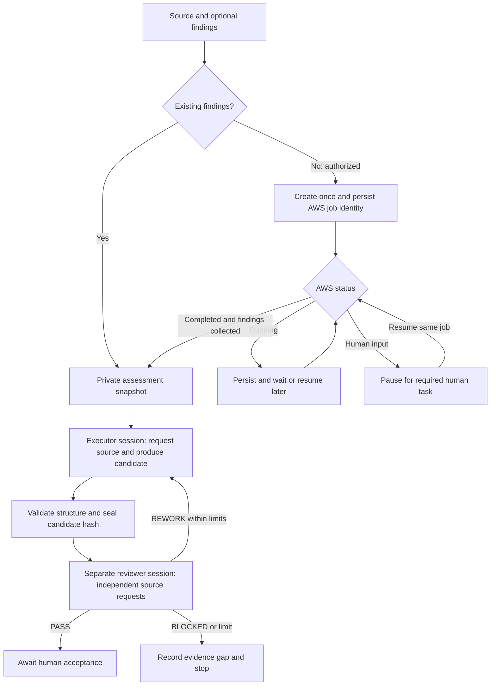

# Kiro automation: start once, return and resume

> Legacy diagnostic interface. For the four-phase POC with explicit assessment approval, Claude Code review and HTML packaging, use the [reframe CLI](cli-guide.md).

**Implemented controller; live Kiro/AWS integration not yet verified.** Offline tests exercise separate roles, automatic handoff/rework, local/S3 import boundaries, and AWS create/wait/resume behavior with fixtures. They do not establish that a real Kiro session or AWS job succeeded.

This first vertical slice validates **one bounded source-derived rule**, using existing or newly generated assessment findings. It does not modernize a full application, generate .NET, execute legacy/target tests, merge a PR, or approve a release.

## The user experience

1. Configure Kiro and AWS access once, outside Git.
2. Give the controller a clean local source checkout and a workspace outside source/framework checkouts.
3. Optionally supply existing findings from a local file/folder or S3 object/prefix. If omitted, authorize a new AWS Transform assessment under the saved configuration.
4. The controller manages records, two Kiro roles, source requests, hashes, review, and bounded corrections. No per-task prompt rewriting or manual handoff is required.
5. Inspect status or resume later using the printed run directory.

## One-time setup

Use Python 3.10+ and Git on macOS/Linux. Install Kiro CLI separately and verify `kiro-cli --version`; the Kiro IDE application alone is not the CLI. Current [Kiro headless documentation](https://kiro.dev/docs/cli/headless/) requires `KIRO_API_KEY`. Supply it through the process environment or approved secret management, never a public file. Follow Kiro's own account and API-key setup instructions.

The controller uses CLI V3 custom profiles and `--no-interactive`, with empty tools/resources, no inherited MCP/Powers, and deny permissions. It sends structured source context over stdin and accepts JSON actions. It never uses `--trust-all-tools`, executes model-supplied commands, or lets either role operate AWS. See [Kiro custom-agent configuration](https://kiro.dev/docs/custom-agents/configuration-reference/). Live compatibility with the installed CLI version must be validated before claiming enforcement on that machine; profiles are not an operating-system sandbox.

For S3 or new AWS jobs, also install/authenticate AWS CLI and the official AWS Transform MCP server (`uvx` is the documented launcher). The Python MCP SDK is optional for existing local/S3 findings but required for new-job mode; for example invoke the controller with `uv run --with 'mcp>=2,<3' scripts/kiro_workflow.py ...`. Use an approved pinned MCP version in deployment settings; the example follows upstream's `@latest` quick-start and is not a reproducible version lock.

Copy [the example settings](../examples/config/kiro-settings.example.json) to a PRIVATE location outside the checkout. Configure:

- `executor_model` / `reviewer_model`: optional supported Kiro model IDs. Null uses Kiro's configured default. Different models are optional, not proof of independence.
- Existing-findings mode: Kiro settings and limits are sufficient; no Transform workspace or new-job permission is used.
- New-job mode: existing `workspace_id`, private `upload_prefix`, optional discovered `orchestrator_agent`, and AWS profile/region through the environment or private `transform.env` settings. This version reuses a configured workspace; it does not create IAM roles, buckets, workspaces, or connectors.
- `output_location`: optional local/S3 text-export location; `{job_id}` and `{run_id}` are substituted. Without it, the adapter retrieves server-listed top-level text artifacts/assets. Nested exports, archives, non-UTF-8 results, excessive artifact counts, or unrecognized service shapes fail explicitly; they are not substituted with job-status metadata.
- `allow_new_assessments`: saved authorization for new jobs. Leave false and pass `--allow-new-assessment` for each new run if you prefer per-run authorization. Required AWS human tasks are never auto-submitted by either policy.

Source upload uses the configured private prefix and a ZIP of tracked, non-hidden files, excluding obvious key/credential filenames. Inspect and authorize the source before allowing upload; filename filters are not secret detection. Repository rights, data classification, AWS connector access, and model-service approval remain the owner's responsibility. Account-specific settings and all outputs stay outside public Git.

## Existing assessment: local or S3

Run from the framework directory. These paths are illustrative and must be your local paths:

```bash
python3 scripts/kiro_workflow.py start \
  --source /path/to/clean-source-checkout \
  --workspace /path/to/private-workspace \
  --settings /path/to/private-settings.json \
  --assessment /path/to/existing-findings \
  --detach
```

For S3, replace the `--assessment` argument with the existing S3 object URI or prefix URI ending in `/`. The controller snapshots supported JSON, Markdown, text, CSV, and YAML findings under the configured byte limit. Archives and binary documents are not automatically extracted. Imported assessment/source association is initially UNVERIFIED; the agents must inspect provenance and cannot call old findings verified for a new source revision.

No new AWS Transform job is created in this mode. S3 reads still require authorized AWS access and may incur normal request/transfer charges.

## New assessment

```bash
uv run --with 'mcp>=2,<3' scripts/kiro_workflow.py start \
  --source /path/to/clean-source-checkout \
  --workspace /path/to/private-workspace \
  --settings /path/to/private-settings.json \
  --allow-new-assessment \
  --detach
```

The controller uploads bounded source to the configured private S3 prefix, creates/starts one mainframe assessment job through the official MCP server, saves its identity, loads job instructions, and polls detailed status. It supplies the source URI and revision in the job objective. Source access and connector/HITL setup may still require a human in AWS Transform; a job request is not proof that the service ingested or assessed all files.

If AWS requires a human decision, the controller records WAITING_FOR_HUMAN and exits. Complete the required task in an authorized AWS interface, then resume. It never submits guessed or empty approval payloads. After service completion and successful findings collection, the two-role source-validation stage starts automatically.

## Return later

Both start commands print a private run directory. Use it unchanged:

```bash
python3 scripts/kiro_workflow.py status --run /path/printed/by/start
uv run --with 'mcp>=2,<3' scripts/kiro_workflow.py resume --run /path/printed/by/start --detach
```

For local/S3-only mode, plain `python3` is sufficient. `--wait` monitors in the foreground; `--detach` starts a local background controller and writes its output to private `controller.log`. It is not a cloud-hosted daemon. Closing a terminal is supported by the detached session; machine shutdown, logout policy, or sleep can stop/delay local processing. AWS continues its own job. Resume after restart; do not issue a fresh start to recover an existing job.

Each watcher invocation stops after `max_polls_per_resume` polls. It does not stop the AWS job. A later resume checks the same recorded job. New source/framework revisions require a new run; do not change the pinned checkout while an existing run is under review.

If automatic result export needs an explicit location, attach findings without creating another job:

```bash
uv run --with 'mcp>=2,<3' scripts/kiro_workflow.py resume \
  --run /path/printed/by/start \
  --assessment /path/to/exported-findings
```

If a create response is lost, NEEDS_RECONCILIATION blocks another creation. The receipt is written before the remote call. A receipt that already contains the job is recovered without another create. A receipt with no successful response points at `attach-job`. Without a receipt, find the job named by this run in AWS and use `attach-job --run ... --job-id ...`. The adapter verifies that the service record references the run before attaching. It does not guess a job ID or silently retry a non-idempotent mutation.

## Handshake and checkpoints



Candidate/review versions, role-specific source contexts, raw CLI receipts, events, run state, and assessment provenance remain in the private run directory. Reviewer context starts without executor hidden reasoning; it receives only the candidate and independent evidence requests. A different session/model does not guarantee correctness. The controller verifies structural and baseline requirements, not the quality of a business oracle.

## Scope and budget in plain language

Scope is the selected source and task objective; the initial automated task validates one bounded rule. Limits are saved once: CLI invocations, correction rounds, per-invocation wall time, source/context/assessment bytes, uploads, and polls per watcher. These avoid unlimited loops and unsafe truncation. Model-call counts mean CLI invocations; provider-internal retries/token usage are not metered here. These limits are NOT a hard dollar cap on Kiro or AWS charges. Use account-level billing controls for financial limits.

No manual prompt-by-prompt operation is required for routine execution. Authentication, missing evidence, uncertain side effects, and explicit human approval boundaries are recorded exceptions, not automatically bypassed decisions.

## Verified versus unverified

Automated tests cover state routing, correction loops, scope/path checks, immutable handoffs, recorded budgets, subprocess configuration, new-job receipts, waiting/resume, and human-input pauses with synthetic fixtures. The real Kiro/AWS flow has not been executed in this repository's development environment because Kiro CLI/headless credentials are not configured there. No new AWS job was started to develop or test this controller.

Run standard checks with `python3 -m unittest discover -s tests -v`. Include the two real local MCP transport checks using `uv run --with 'mcp>=2,<3' python -m unittest discover -s tests -v` (they skip if the optional SDK is absent). A live acceptance run must verify CLI profile behavior, structured replies, service response shapes, connector/source ingestion, output retrieval, interruption/resume, and independent review before advertising a proven end-to-end workflow.
